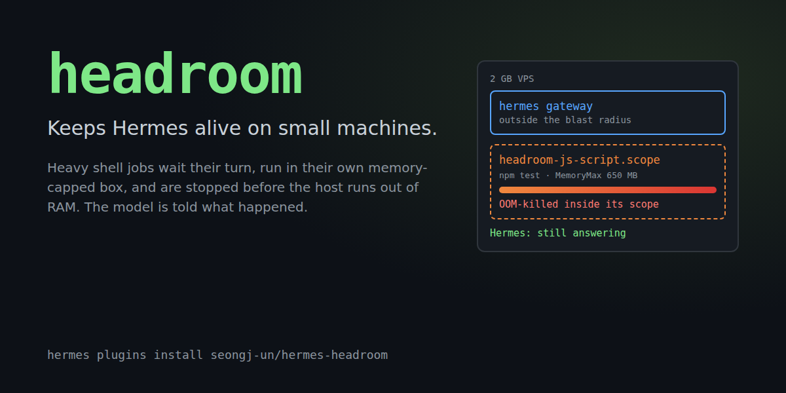

# headroom



**Keeps Hermes alive on small machines.** A `npm install`, a test suite or a build that blows
past the RAM of a 1-2 GB VPS or a Raspberry Pi normally takes the agent down with it: the
gateway gets OOM-killed or the box swaps itself into a coma, and your Discord/Telegram bot goes
silent. headroom puts every heavy shell job in its own memory-capped box, queues them so only one
runs at a time, and tells the model what happened when something does not fit, so it can retry
with a lighter approach instead of you SSH-ing in to reboot.

```
$ hermes headroom selftest
headroom selftest: PASS
  memory: 1012 MB available of 1962 MB, 1 CPU
  PSI memory pressure: available
  isolation: systemd --user scopes with the memory controller
  test process: tried to allocate 800 MB inside a 64 MB scope
  kernel OOM-killed it inside headroom-selftest-3f1c9a2e.scope (cgroup oom_kill events: 1)
  this process (pid 6963) was not touched
```


## What it does

For every `terminal` call the model makes, headroom decides whether the command is **heavy**
(package installs, builds, test runners, compilers, `docker build`, ffmpeg/whisper/llama,
browsers, nested `hermes chat` / coding agents). Light commands are not touched. Heavy ones get:

1. **Lightened** (before approval, so what you approve is what runs): `jest --runInBand`,
   `pytest -n 0`, `make -jN`, `cargo -j N`, `go -p N`, `gradle --max-workers=N`,
   `playwright --workers=1`, and a Node heap cap (`NODE_OPTIONS=--max-old-space-size=...`) so V8
   fails with a readable "heap out of memory" instead of being SIGKILLed.
2. **Queued** machine-wide. One heavy job at a time on a small box (configurable), shared by every
   Hermes process on the machine: the gateway, CLI sessions, kanban workers and other profiles.
   A job also waits until enough memory is free. If it waits too long, it is refused with a
   message naming the job that holds the slot.
3. **Isolated.** After Hermes spawns the approved command, headroom moves the shell (and anything
   it already forked) into its own transient `systemd --user` scope with `MemoryMax`,
   `MemorySwapMax` and `OOMPolicy=continue`, and raises its OOM score. If the job outgrows its
   cap, the kernel kills the biggest process **inside the scope**; the shell survives, reports
   exit 137, and Hermes, which stays outside the scope, never notices.
4. **Watched.** A watchdog thread stops the newest heavy job if available memory drops below a
   critical line, or if Hermes' *own* cgroup starts stalling on memory (cgroup PSI). A job
   thrashing inside its own scope is not a reason to kill it; Hermes being hurt is.
5. **Explained.** The tool result carries a `headroom` object, and the model reads it:

```json
"headroom": {
  "memory_cap_mb": 650, "swap_cap_mb": 256, "isolated": true, "peak_mb": 650,
  "lightened": ["capped the Node heap at 455 MB (NODE_OPTIONS)"],
  "oom_killed": true,
  "note": "`npm test` hit its 650 MB memory cap and the kernel killed its largest process (usually exit code 137, 'Killed'). Hermes was not affected. Retry with less parallelism or a smaller workload, e.g. jest --runInBand / vitest --maxWorkers=1, a lower NODE_OPTIONS=--max-old-space-size, or building one package at a time."
}
```

   Background jobs that get killed leave a note that is injected into the model's next turn.
   When memory is tight, the model also gets a one-line heads-up (at most every 10 minutes per
   session) to prefer single-worker options.

This needs a plugin: a prompt or a skill can ask the model to be careful, but it cannot hold a
lock across processes, move a PID into a cgroup, read cgroup OOM counters or kill a job when
the host runs out of memory.

## Install

```bash
hermes plugins install seongj-un/hermes-headroom --enable
hermes headroom selftest      # proves isolation works on this machine
```

The middleware applies to new sessions. Restart the gateway (`systemctl --user restart
hermes-gateway`) to cover messaging platforms right away.

Requirements: Hermes `>= 0.22.6`, Linux. Isolation additionally needs systemd with the memory
controller delegated to the user manager (the default on Ubuntu 22.04+, Debian 12+, Fedora,
Arch; for a service account, enable lingering with `loginctl enable-linger`). Without systemd,
headroom still queues heavy jobs, raises their OOM score, lightens them and runs the watchdog,
which stops a job by its process group.

## Commands

| Where | Command | What it shows |
| --- | --- | --- |
| chat | `/headroom` | free memory, swap, pressure, the cap the next job would get, running jobs (here and in other Hermes processes), largest processes |
| chat | `/headroom events` | queue waits, caps, peaks, OOM kills, watchdog stops |
| chat | `/headroom explain <command>` | heavy or light, the cap it would get, the rewrite |
| chat | `/headroom selftest` | the isolation self-test above |
| model | `headroom_status` tool | the same snapshot as JSON, plus `explain` |
| shell | `hermes headroom status \| events \| explain CMD \| selftest` | same, from a terminal |

The status also lists the largest processes and flags the ones Hermes started. On a 2 GB box
that is often the surprise: a TypeScript language server pair can hold 500 MB.


## Settings

All in the Desktop app under Settings > Plugins > headroom, or with
`hermes config set plugins.entries.headroom.settings.<key> <value>`. Every number defaults to
`0` = auto, resolved against the machine when a job starts, so one config works on a 1 GB VPS
and a 64 GB workstation.

| Key | Default | Meaning |
| --- | --- | --- |
| `mode` | `enforce` | `observe` only logs what it would do; `off` disables everything |
| `max_heavy_jobs` | auto | machine-wide heavy jobs at once: 1 below 4 GB RAM, 2 below 16 GB, else 4 |
| `reserve_mb` | auto | kept for Hermes and the system, never given to a job: 15% of RAM, 256 MB to 2 GB |
| `job_memory_max_mb` | auto | per-job cap: what is free when it starts, minus the reserve |
| `swap_mb` | `256` | swap a job may use beyond its cap; `-1` = unlimited |
| `min_start_mb` | auto | free memory beyond the reserve a job needs to start: 10% of RAM, 192 MB to 1 GB |
| `queue_timeout_s` | `300` | how long a heavy command waits before it is refused with an explanation |
| `critical_mb` | auto | watchdog line for available memory: 5% of RAM, 96 to 512 MB |
| `lighten` | `true` | apply the single-worker rewrites |
| `isolate` | `true` | use systemd scopes |
| `extra_heavy_patterns` | `[]` | regexes for your own heavy commands, e.g. `^python3? train\.py` |
| `exclude_patterns` | `[]` | regexes for commands never to treat as heavy |

## How a heavy command flows

```
model: terminal("cd web && npm test")
  |
  |- tool_request middleware   heavy? -> add NODE_OPTIONS heap cap      (before approval)
  |- Hermes approval / guards  sees and approves the lightened command
  |- tool_execution middleware wait for a machine-wide slot + free memory
  |     |- next_call()         Hermes spawns `bash -c ...` exactly as approved
  |     |- tracker thread      finds that shell among this process's children,
  |     |                      StartTransientUnit(headroom-js-script-XXXX.scope,
  |     |                        MemoryMax, MemorySwapMax, OOMPolicy=continue, Delegate)
  |     |                      oom_score_adj=900, samples memory.peak / memory.events
  |     |- watchdog thread     MemAvailable < critical, or Hermes' cgroup PSI high -> stop newest job
  |- result + "headroom": {...}  the model reads cap, peak, oom_killed, note
```

## Limitations

- Enforcement is Linux-only. On macOS and Windows the plugin loads and reports, and does nothing
  else.
- Memory a process allocates in the first moments before it is moved (headroom polls every 5 ms)
  stays charged to Hermes' cgroup. Real installs and builds ramp up over seconds, so in practice
  this is a few MB.
- `docker build` / `docker compose up` do their work in the Docker daemon, outside the process
  tree: those are queued but cannot be capped.
- Only the local terminal backend is isolated. With Docker, SSH or cloud sandboxes the heavy work
  runs elsewhere, and only queueing applies.
- The classifier works from command words. A bespoke heavy script (`python3 train.py`) needs an
  `extra_heavy_patterns` entry.

## What it touches (disclosure)

- **Shell commands:** `busctl --user` (StartTransientUnit, AttachProcessesToUnit) and
  `systemctl --user kill / reset-failed`, only for its own `headroom-*.scope` units; one
  `sleep` placeholder process per isolated job, which keeps the scope's counters readable until
  the job is done.
- **Reads outside its data:** `/proc/meminfo`, `/proc/pressure/memory`, `/proc/<pid>/{stat,status,
  cmdline,cgroup}` for this user's processes (to find the shell it spawned and to list the
  largest processes), and the cgroup files of its own scopes and of Hermes' cgroup.
- **Writes:** `oom_score_adj` of the job's processes (raised only), an event log at
  `<HERMES_HOME>/plugin-data/headroom/events.jsonl`, and slot lock files in
  `$XDG_RUNTIME_DIR/hermes-headroom/`.
- **Kills:** only processes inside its own scopes (or, without systemd, the process group of a
  job it is tracking), when the watchdog fires.
- **Network:** none. No telemetry, no credentials.
- **Core internals:** `tools.interrupt.is_interrupted()` (read-only, guarded) so that `/stop`
  cancels a command waiting in the queue. Without it, a waiting command times out normally.
- Approvals are never bypassed: rewrites happen before approval, admission and isolation happen
  after it, and both only restrict what runs.

## Development

```bash
uv venv .venv && uv pip install --python .venv/bin/python "pytest>=8,<9"
cd tests && ../.venv/bin/python -m pytest -q     # 70+ tests; the systemd ones run real scopes and real OOM kills
hermes plugins validate .
```

`demo/leaky-report` is a tiny Node project whose test fixture needs more than a gigabyte of
heap; it is what the demo video runs.

## License

MIT
